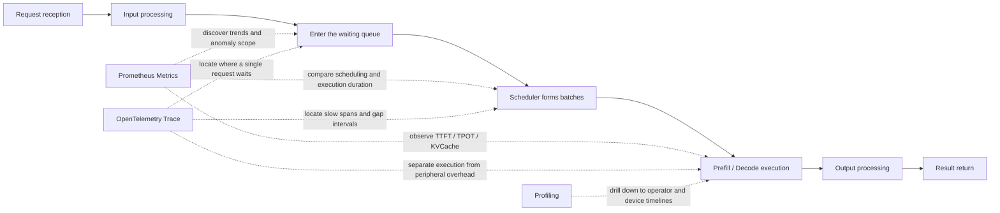

# vLLM-Ascend Observability Performance Diagnostics Guide

## 1. Document Objectives

This document provides a performance problem diagnosis flow based on Metrics and Tracing. After completing the operations in this document, developers can independently do the following:

1. Use Metrics to confirm the scope of impact and the abnormal phase of a performance problem.
2. Select the traces to be analyzed from the abnormal time window.
3. Locate the bottleneck phase using span durations, parent-child relationships, gap intervals, and attributes.
4. Complete a before-and-after comparison under the same load.

This document applies to the vLLM-Ascend online inference service. Operators, kernels, HCCL, and device timelines are outside the scope of Metrics and Tracing; once a problem is narrowed down to the model execution or communication phase, continue the drill-down with the Profiling capability of msServiceProfiler.

## 2. Diagnosis Targets

### 2.1 Request Lifecycle

An inference request passes through request reception, input processing, scheduling, model execution, output processing, and result return. The relationship between these phases and the observability data is as follows.



### 2.2 Division of Work Between Metrics and Tracing

| Data | Question It Answers | Suitable Analysis Scope | Conclusion It Cannot Prove Alone |
|---|---|---|---|
| Metrics | When it becomes slow, which instances become slow, and how many requests are affected | Minute-level trends, quantiles, capacity, errors, and instance differences | Which function a single request waits in |
| Tracing | Which phase a specific request is slow in and how the phases are related | Single request, single batch, and cross-process span relationships | The proportion of the problem among all requests |
| Profiling | Which operator, communication, or kernel inside model execution is slow | Host, device, operator, and communication timelines | The sustained scope of an online problem |

Metrics and Tracing are two analysis paths that can be executed independently, and they can also be used together when the data is complete.

| Analysis Path | Entry Point | Conclusions It Can Support |
|---|---|---|
| Independent Metrics analysis | SLO alarms, load test results, or Grafana anomalies | The abnormal time, scope of impact, and capacity- or phase-level bottlenecks; it cannot show the specific call chain of a request |
| Independent Tracing analysis | Trace ID, request ID, service logs, or long-tail traces in Jaeger | The critical path, slow spans, waiting positions, and error propagation of a target request; it cannot show the proportion of the problem among all requests |
| Joint Metrics and Tracing analysis | An abnormal window in Metrics and the associated traces | Confirms both the problem scope and the request-level path, with the most complete evidence coverage |

Which path to choose depends on the current problem and the available data. Do not make Metrics a precondition for Tracing, or Tracing a mandatory condition for a root cause judgment from Metrics.

## 3. Preparation Before Analysis

### 3.1 Fixing the Comparison Conditions

The following conditions must stay identical before and after optimization:

- Versions of the model, vLLM, vLLM-Ascend, CANN, and msServiceProfiler.
- NPU model, number of devices, parallelism configuration, and number of instances.
- Input length, output length, concurrency, request arrival pattern, and load test duration.
- Service startup parameters, environment variables, and sampling configuration.
- Number of warm-up requests and the statistics window.

If the version, load, or resources change, the data cannot be compared directly against the same baseline.

### 3.2 Recording the Diagnosis Context

Record the following information at the start of each analysis.

| Item | Content to Record |
|---|---|
| Problem time | Start and end time, and the time zone |
| Scope of impact | Instance, DP domain, rank, and request type |
| SLO | The abnormal items among TTFT, TPOT, end-to-end latency, and throughput |
| Load | Concurrency, QPS, and input/output token distribution |
| Version | vLLM, vLLM-Ascend, CANN, and msServiceProfiler |
| Configuration changes | Service parameters, routing, parallelism, device memory, and scheduling configuration |
| Control window | A normal time window under the same load |

If no normal window exists, collect one baseline round under a fixed load before starting the fault analysis.

### 3.3 Checking the Observability Chain

Tracing relies on the native OpenTelemetry capability of the vLLM V1 engine. To reduce the maintenance cost of older versions, the lower bound of the Hook Tracing support policy in this material is vLLM-Ascend `v0.20.0`. During actual installation, choose a complete combination from the official compatibility matrix; the first public combination that satisfies this boundary is vLLM-Ascend `v0.20.2rc1` with vLLM `v0.20.2`. For the version basis, Jaeger deployment, startup parameters, network debugging, and verification methods, see *[vLLM Hook Tracing User Guide](../user_guide/vLLM_hook_tracing_instruct.md)*. Independent Metrics analysis does not require this Tracing version condition.

| Check Item | Pass Criteria | Handling After Failure |
|---|---|---|
| Metrics data endpoint | The metrics required for this analysis exist under `/metrics` | Check the metric collection status, the Prometheus multiprocess directory, and the version symbols |
| Tracing data endpoint | The target service and real inference traces exist in Jaeger | Check `--otlp-traces-endpoint`, `MS_TRACE_ENABLE=1`, and the network |
| Hook spans | The target scheduler, model, or output spans exist in Jaeger | Check whether the YAML symbols match the current version |
| Request association | At least one of the parent-child relationship, the same trace ID, links, and `request.ids` holds | Perform only phase-level analysis and switch to Perfetto or Profiling for timeline attribution |
| Node time | Metrics, Jaeger, and service logs use the same time zone | Unify the time zone and synchronize the node clocks |

If the Metrics data endpoint does not pass, stop the Metrics path; Tracing can still be analyzed independently. If the Tracing data endpoint does not pass, stop the Tracing path; Metrics can still be analyzed independently. If the request association does not pass, Tracing supports only operation-level or phase-level statistics and cannot produce request-level chain conclusions.

## 4. Joint Diagnosis Flow

This chapter describes the joint flow when Metrics and Tracing data are both available. When using Metrics only, perform steps 1 to 3 and form the metric evidence according to chapter 5; when using Tracing only, enter from step 4 and complete the request-level localization according to chapter 6. Both independent paths require the single-variable re-test in step 7.

### Step 1: Determining the Abnormal SLO

First determine whether the anomaly is in the first token, subsequent tokens, end-to-end latency, or throughput.

| Symptom | Where to Look First |
|---|---|
| TTFT rises, TPOT is stable | Input processing, waiting, scheduler, Prefill, KVCache |
| TTFT is stable, TPOT rises | Decode, model execution, sampling, communication |
| TTFT and TPOT rise at the same time | Global load, model execution, resource contention, instance skew |
| P99 rises, P50 is stable | A few long requests, hotspot instances, preemption, recomputation, abnormal dependencies |
| Throughput drops and NPU utilization is low | Scheduler, host dispatch, IPC, synchronous waiting |
| Throughput drops and the NPU stays fully loaded | Model computation, communication, batch or token scale |

### Step 2: Checking Whether the Load Has Changed

Compare the number of requests, input tokens, output tokens, batch size, and request phase between the abnormal window and the normal window. If the load has changed, group by the same input/output length, concurrency, and phase first, and then compare the latency.

When the load stays the same and the duration metrics rise, the performance change comes from the service execution path or the runtime environment. When the duration grows with the token count or batch, continue by judging whether the growth matches the baseline relationship.

### Step 3: Completing the First-Level Determination with Metrics

The TTFT and TPOT used in this step are the metrics registered by the current vLLM adapter of ms-service-metric. The logical names in this document correspond to the Prometheus series as follows.

| Logical Name | Type | Prometheus Series | Data Source |
|---|---|---|---|
| `fine_grained_ttft` | Histogram | `vllm_profiling_fine_grained_ttft_bucket/_sum/_count` | vLLM `IterationStats.time_to_first_tokens_iter` |
| `fine_grained_tpot` | Histogram | `vllm_profiling_fine_grained_tpot_bucket/_sum/_count` | `mean_time_per_output_token` of completed requests in vLLM |
| `engine:generate:duration` | Histogram | `vllm_profiling_engine:generate:duration_bucket/_sum/_count` | Engine-side generation duration of `AsyncLLM.generate` |

`engine:generate:duration` is the server-side engine duration and is not the same as the end-to-end request duration observed by the load test client. For the client-side end-to-end SLO, use the load test tool results; the two must not be mixed.

Perform the first-level determination in the following order:

1. Check `fine_grained_ttft`, `fine_grained_tpot`, `engine:generate:duration`, and the client-side end-to-end latency to confirm the affected SLO and to distinguish the server-side engine duration from the total client latency.
2. Check `waiting_batch_size`, `batch_size`, and `scheduler:duration` to determine whether queueing and scheduling are abnormal.
3. Check `free_kvcache_blocks`, `allocated_kvcache_blocks`, `block_allocate_failures`, and the recomputation/fallback counters to determine whether the KVCache is limiting scheduling.
4. Check `executor:execute_model:duration`, `executor:model_runner_execute_model:duration`, and `npu:forward_duration` to determine whether model execution has become slower.
5. Break the results down by labels such as `instance`, `dp`, `phase`, and `rank` to confirm whether the problem is global or a local hotspot.

When the Metrics evidence is complete, output a clear classification among request entry, scheduling, KVCache, model execution, output processing, abnormal states, or instance load imbalance. When the evidence is insufficient, record the phases that have been ruled out and those still to be checked.

### Step 4: Selecting the Trace to Analyze

For independent Tracing analysis, locate the target trace by trace ID, request ID, service log timestamps, or a long-tail point in Jaeger. For joint analysis, use the abnormal time, instance, DP domain, and request phase from Metrics to narrow the Jaeger query range.

When a normal baseline is available, select two observation groups under the same service:

- Abnormal group: the root trace of the target request in the abnormal window, or the set of hook spans associated through links or `request.ids`.
- Control group: a normal observation group with the same request type, token scale, batch, and phase.

The request scale used for the regression comparison must be identical. When no normal baseline exists, you can still locate the duration positions inside that request from the parent-child relationships, the critical path, Error/Status, and span attributes of a single trace, but you cannot conclude that it became slower relative to the baseline.

### Step 5: Locating the Request Path with Tracing

First determine the span association form, and then check in the following fixed order:

1. Check the total duration of the root span to confirm that it covers the target request.
2. Check `request.id`, `request.ids`, trace IDs, and span links to confirm cross-request, cross-batch, or cross-process association.
3. In the same-trace-ID case, check the parent and child spans directly; in the span-links case, open the associated spans along the links.
4. Check `vllm.scheduler.schedule` to confirm the scheduling duration and frequency.
5. Check `vllm.model.execute` and `vllm_ascend.model_runner.execute` to distinguish the peripheral overhead of the executor from the execution duration of the ModelRunner.
6. Check `vllm.output.process` to confirm whether output processing forms a long tail.
7. Analyze the gaps between spans only for the same trace ID or a unified Perfetto timeline, to locate queueing, synchronization, and IPC wait intervals.
8. Check Error/Status to confirm whether abnormal requests coincide with the performance problem.

The total duration of a parent span includes its child spans. When judging the overhead of the parent phase itself, take the child span durations and the gap intervals into account; do not count the whole parent span duration as the parent function's own duration.

A single hook span records up to 128 `request.ids` and span links. When a batch contains more than 128 requests, use `batch.request_count`, `batch.scheduled_tokens`, aggregated Metrics, and Perfetto/Profiling data to complete the batch-level analysis.

### Step 6: Forming the Evidence Chain

Form the evidence chain according to the analysis path actually used.

| Analysis Path | Evidence Required for the Conclusion | Boundary of the Conclusion |
|---|---|---|
| Independent Metrics analysis | SLO changes, at least two types of phase or capacity metrics that change together, and evidence that the adjacent phases are ruled out | It can provide overall or instance-level phase conclusions, but not a single-request call chain |
| Independent Tracing analysis | Target request identity, complete association relationships, and key span, error, or same-timeline waiting evidence | It can provide path conclusions for the target request, but cannot be extrapolated to all requests |
| Joint analysis | The SLO symptoms, the Metrics determination, and the Trace localization correspond to each other | It can provide both the scope of impact and the request-level root cause |

Joint analysis example: `waiting_batch_size` and `scheduler:duration` rise together while the model execution metrics stay at the baseline; the scheduler span of the abnormal group becomes longer while the model span is the same as in the control group. This evidence chain localizes the bottleneck to the scheduling phase.

### Step 7: Optimizing a Single Variable and Re-Testing

Change only one type of parameter or one implementation point at a time. Re-test with exactly the same load as the baseline, and check the data that the current path can observe:

- Whether the target SLO recovers.
- When Metrics is used, whether the target phase metrics recover.
- When Tracing is used, whether the corresponding span or the gap interval on the same timeline becomes shorter.
- Whether throughput, the error rate, device memory, and other SLOs regress.

The diagnosis loop ends when the target symptom recovers, the direct evidence of the current analysis path recovers, and no other regression has been introduced. When Metrics and Tracing are both available, both types of evidence must be re-tested.

## 5. Metrics Analysis Method

### 5.1 Reading Metric Types Correctly

| Type | How to Read | Typical Mistake |
|---|---|---|
| Gauge | View the current value, minimum, maximum, and instance differences directly | Using `rate()` on a gauge |
| Counter | Use `rate()` for the rate and `increase()` for the window increment | Treating the cumulative value directly as the current number of faults |
| Histogram | Use `_bucket` to calculate quantiles and `_sum/_count` to calculate the average | Comparing `_sum` or `_count` directly |

### 5.2 Common PromQL Queries

The following queries use the `vllm_profiling_` prefix actually exported by the tool. Add filter conditions such as `instance`, `dp`, and `phase` according to your deployment.

#### Scheduling Duration P99

```promql
histogram_quantile(
  0.99,
  sum by (le, instance, dp) (
    rate(vllm_profiling_scheduler:duration_bucket[5m])
  )
)
```

#### Average Model Execution Duration

```promql
sum by (instance, dp, phase) (
  rate(vllm_profiling_executor:execute_model:duration_sum[5m])
)
/
sum by (instance, dp, phase) (
  rate(vllm_profiling_executor:execute_model:duration_count[5m])
)
```

#### KVCache Utilization

```promql
100 * (
  1 -
  vllm_profiling_free_kvcache_blocks
  /
  vllm_profiling_total_kvcache_blocks
)
```

#### KVCache Allocation Failure Increment

```promql
sum by (instance, dp) (
  increase(vllm_profiling_block_allocate_failures_total[5m])
)
```

#### Increment of Requests Falling Back from Running to Waiting

```promql
sum by (instance, dp) (
  increase(vllm_profiling_running_to_waiting_count_total[5m])
)
```

#### Scheduling Recomputation Increment

```promql
sum by (instance, dp) (
  increase(vllm_profiling_scheduler:recompute_events_total[5m])
)
```

When aggregating the quantiles of a histogram by the target labels, `le` must be kept. The `_sum` and `_count` of an average duration query must use the same window and the same label set.

### 5.3 Combination Judgment Rules

A single metric only shows a state; the root cause is confirmed by a combination of metrics.

| Metric Combination | Determination Conclusion | Next Step |
|---|---|---|
| TTFT rises; waiting rises; model execution is stable | The extra request duration occurs before model execution | Check the scheduler, the KVCache, and the gap intervals on the same Trace/Perfetto timeline |
| waiting rises; scheduler P99 rises; NPU utilization is low; model duration is stable | The scheduling or host path is the bottleneck | Compare the scheduler span and the model span |
| Free blocks stay low; allocation failures increase; waiting and TTFT rise together | KVCache capacity limits requests from entering the execution phase | Check long requests, concurrency, device memory configuration, and instance skew |
| TPOT rises; execute model and forward rise together; scheduler is stable | The model execution phase has become slower | Compare the model span and continue the drill-down with Profiling |
| execute model rises; model runner is stable | Extra duration exists around the executor | Check IPC, synchronization, and data preparation |
| output processor rises; model is stable | The output processing phase has become slower | Check the output processing span, token post-processing, and the return path |
| Only some dp/rank are abnormal | Local load or resource imbalance | Compare the request and token scale of abnormal and normal dp/rank |

"Stays low" and "rises" are both judged against a normal window under the same load, and the anomaly must cover consecutive collection points. A single collection point is not root cause evidence.

## 6. Tracing Analysis Method

### 6.1 Spans and Localization Directions

| Span | Actual Instrumentation Point | Localization Direction |
|---|---|---|
| Native vLLM request root span | Native vLLM tracing | Request entry and end-to-end context |
| `vllm.scheduler.schedule` | `Scheduler.schedule` | Scheduling duration, batch organization, and request association |
| `vllm.model.execute` | Executor `execute_model` | Total execution duration at the executor layer |
| `vllm_ascend.model_runner.execute` | `NPUModelRunner.execute_model` | Execution duration of the Ascend ModelRunner |
| `vllm.output.process` | `OutputProcessor.process_outputs` | Output processing and request completion |

Hook span names come from the default `service_profiling_symbols.yaml`, and the symbols are version-constrained. The `request` adapter on `AsyncLLM.add_request` only registers the native vLLM request context and does not create a duplicate `vllm.request` root span. If a span is missing, first check whether the current version matches the corresponding symbol, and then check the hook logs and context propagation.

### 6.2 Comparing Normal and Abnormal Observation Groups

Record the total trace duration, the scheduler/model/model runner/output spans, the largest gap interval on the same timeline, and the request/batch attributes for the normal and the abnormal observation group, calculate the differences, and fill in the conclusion. Use the template in chapter 8 as the record format.

In the same-trace-ID case, the differences must explain the main change in the total trace duration. In the span-links case, compare the timestamps and durations of the associated spans separately; do not interpret the interval between different traces on the Jaeger page as waiting. If it cannot be explained, continue checking the non-instrumented intervals or proceed to Profiling analysis.

### 6.3 Common Chain Patterns

- The scheduler span becomes longer while the model span is unchanged: the scheduler itself has become slower.
- The scheduler span is not longer, but the gap from the request to the model in the same trace or Perfetto timeline becomes longer: the request is queueing, synchronizing, or waiting for resources.
- `vllm.model.execute` becomes longer and `vllm_ascend.model_runner.execute` becomes longer at the same time: the duration has moved into the ModelRunner execution phase.
- `vllm.model.execute` becomes longer while the ModelRunner span is unchanged: the duration is outside the executor; check IPC, synchronization, and data preparation.
- The output span becomes longer while the model span is unchanged: output processing forms a long tail.
- The trace has only a few spans and lacks request association: the chain is incomplete and cannot be used for phase duration attribution.

### 6.4 Jumping from Metrics to a Trace

Associate Metrics and traces by using the same abnormal time window, and prefer `request.id`, `request.ids`, and the trace context passed in from the service side. When there are no request-level metrics, narrow the range as follows:

1. Use Metrics to determine the start and end time of the anomaly.
2. Use the instance, DP, phase, and error status to determine the abnormal groups.
3. In Jaeger, restrict the service, the time, and the minimum duration.
4. From the root traces or hook spans, select the observation group that is consistent with the abnormal groups.
5. Confirm the parent-child relationship or span links first, and then select a normal observation group with the same window and group as the control.

## 7. Typical Cases

### 7.1 A New Evaluation Dataset Triggers a KVCache Capacity Bottleneck

For the complete case, see [A New Evaluation Dataset Triggers a KVCache Capacity Bottleneck](../best_practices/kv_block_shortage.md). This is a real Metrics determination case; the original historical data was not kept, so this document does not add numbers, screenshots, or trace conclusions. The reusable evidence chain is as follows:

1. After the evaluation dataset is replaced, TTFT and TPOT deteriorate at the same time.
2. The waiting queue grows in the same window.
3. `free_kvcache_blocks` stays close to 0.
4. `scheduler:recompute_events` keeps increasing, and the scheduler frequently triggers recomputation.
5. Under the original concurrency, the KVCache demand of the new dataset exceeds the stable capacity of a single instance.
6. Reduce concurrency as a single variable, and re-test the level, recomputation, TTFT, TPOT, and throughput with the same new dataset.

### 7.2 Speculative Inference Acceptance Rate Drops After Dynamic EPLB Is Enabled

For the complete case, see [Speculative Inference Acceptance Rate Drops After Dynamic EPLB Is Enabled](../best_practices/speculative_acceptance_rate_with_dynamic_eplb.md). The standard evidence chain is as follows:

1. When dynamic EPLB is disabled, the speculative inference acceptance rate curves of the instances are tight and stable.
2. After dynamic EPLB is enabled, the acceptance rate curves are spread out and shift down as a whole, and some instances drop to near 0.
3. `num_spec_tokens`, the dataset, the request order, the concurrency, the sampling parameters, the versions, and the parallelism configuration stay identical.
4. The acceptance rate drop and the TPOT or output token throughput degradation align in the same window.
5. waiting, the KVCache, model execution, and service errors show no corresponding anomaly, which rules out the adjacent phases.
6. Disable dynamic EPLB and re-test the acceptance rate, performance, and output correctness.

The available evidence of this case supports a configuration-level conclusion: dynamic EPLB is the regression trigger for the current combination. A code-level cause would require step-by-step accepted token data, expert mapping updates, and cross-rank consistency data; this document makes no inference without evidence.

### 7.3 Excessive Scheduler Duration Causes a Throughput Drop

For the complete case, see [Excessive Scheduler Execution Time](../best_practices/scheduler_high_latency.md). The standard evidence chain is as follows:

1. waiting keeps growing, running does not reach the configured upper limit, and NPU utilization is low.
2. `scheduler:duration` P99 rises while the model execution metrics stay at the baseline.
3. The `vllm.scheduler.schedule` of the abnormal observation group is clearly longer than that of the normal observation group under the same load.
4. `vllm.model.execute` and `vllm_ascend.model_runner.execute` are close to those of the normal observation group.
5. The unified timeline or Profiler data shows stable gap intervals in the scheduling phase.
6. After the scheduling logic, CPU resources, or dispatch mode are optimized, the scheduler P99, waiting, throughput, and NPU utilization all recover at the same time.

## 8. Diagnosis Record Template

Copy the following template to record a complete analysis:

```text
Problem:
Analysis path: Metrics / Tracing / joint analysis
Abnormal time window:
Normal control window:
Environment and versions:
Load conditions:

1. SLO symptoms
- Abnormal metrics:
- Abnormal scope:
- Difference from the baseline:

2. Metrics determination
- Whether this path uses Metrics:
- Metrics used:
- Synchronized change relationship:
- Determined phase:
- Phases ruled out and the evidence:

3. Tracing localization
- Whether this path uses Tracing:
- Abnormal observation group (trace ID, links, or request.ids):
- Control observation group (trace ID, links, or request.ids):
- Main span differences:
- Gap intervals or attribute differences on the same Trace/Perfetto timeline:

4. Root cause
- Root cause:
- Scope of the conclusion: overall/instance/observed requests
- Symptom evidence:
- Determination evidence:
- Localization evidence:

5. Handling and re-test
- Single-variable change:
- SLO re-test result:
- Metrics re-test result:
- Trace re-test result:
- Side effect check:
```

For data items that were not used, enter "Not applicable". Independent Metrics analysis does not add trace evidence, and independent Tracing analysis does not add metric trends.

## 9. Data Credibility Checks

If any of the following occurs, repair the observability chain before performing performance attribution.

| Situation | Handling |
|---|---|
| Metrics has no sample points in the target window | Check the scrape targets, the scrape interval, service restarts, and the multiprocess directory |
| Counters reset to zero after a process restart | Use `rate()` or `increase()`, and break the results down by instance and process |
| A histogram has no `_bucket` | Quantiles cannot be calculated; use `_sum/_count` to calculate the average instead |
| A trace has only 1 to 2 spans | Check context propagation, span links, the OTLP configuration, and hook matches |
| The span time order is abnormal | Unify the node clocks and check the time zone; cross-node gap intervals must not be used directly for attribution |
| The Metrics and trace times are inconsistent | Record the abnormal window with the same time zone and absolute time |
| The abnormal and normal traces have different request scales | Select control data with the same token scale, batch, and phase again |

## 10. Performance, Security, and Compatibility

### 10.1 Collection Overhead

- Use only a limited set of labels for metrics. Do not use request IDs, full URLs, prompts, or arbitrary user input as metric labels.
- Set the Tracing sampling rate according to the diagnosis objective. Use full sampling only in a controlled load test window, and restore the production sampling policy after the diagnosis.
- When Profiling and Tracing are enabled at the same time, measure the collection overhead under a fixed load first, and then interpret the service performance data.

### 10.2 Data Security

- Record only the request IDs, batches, token counts, status, and phase information needed for localization in trace attributes.
- Do not record prompts, generated content, authentication headers, cookies, tokens, or user privacy data.
- Expose the Prometheus, Jaeger, and OTLP ports only to the management network or authorized clients.
- Before sharing traces, screenshots, or diagnosis records, mask request IDs, IP addresses, host names, and service identifiers.

### 10.3 Version Compatibility

- Metric names follow the actual output of `/metrics` in the current version; the default metrics all carry the `vllm_profiling_` prefix.
- Whether a span exists depends on the hook symbols matched by the current version. After upgrading vLLM or vLLM-Ascend, verify the Metrics or Tracing data endpoint you plan to use; when using Tracing for request-level analysis, additionally verify the request association.
- The combination judgments in this document do not depend on fixed hardware thresholds and remain applicable to later versions. When metrics are added or renamed, update the metric table, the PromQL, the cases, and the navigation accordingly.

## 11. New Developer Acceptance

The acceptance test consists of two independent tasks, and the two types of data do not have to come from the same fault:

1. Metrics task: provide normal and abnormal metric windows. The new developer points out the affected SLO, completes the phase determination with at least three metrics that change together, rules out at least one adjacent phase, and provides a single-variable handling plan and the re-test metrics.
2. Tracing task: provide a target trace ID or request ID and the corresponding trace data. The new developer confirms the request association, locates the critical path or the error phase, explains the scope of the conclusion, and provides the trace re-test items after handling.

The acceptance test is passed when the conclusions of both tasks are consistent with the data. When the data contains both Metrics and traces, a joint analysis task can be added to check whether the abnormal scope and the request path corroborate each other. Use the template in chapter 8 for the acceptance record and enter "Not applicable" for unused data items; do not add evidence just to fill the template.

## 12. Related Documents

- [vLLM Serving Prometheus Data Monitoring Tool User Guide](../user_guide/vLLM_metrics_tool_instruct.md)
- [vLLM Hook Tracing User Guide](../user_guide/vLLM_hook_tracing_instruct.md)
- [vLLM Serving Performance Collection Tool User Guide](../user_guide/vLLM_service_oriented_performance_collection_tool.md)
- [msServiceProfiler Case Studies](../best_practices/README.md)
