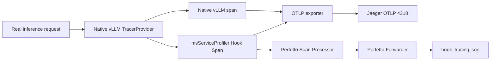

# vLLM Hook Tracing User Guide

## Introduction

vLLM Hook Tracing uses the existing Hook/YAML mechanism of msServiceProfiler to create OpenTelemetry spans for request scheduling, model execution, and output processing. The tool currently supports two ways of displaying the data, Jaeger and Perfetto:

- Jaeger: hook spans reuse the global provider and OTLP exporter of vLLM.
- Perfetto: optionally writes msServiceProfiler hook spans to an additional Chrome Trace JSON.

>[!NOTE]
>
>Tracing and profiling are two independent delivery flows: Tracing does not need `enable.json` or `parse`; profiling still follows the original flow to generate deliverables such as CSV, DB, and offline Chrome Trace files.

## Supported Products

> [!NOTE]
>
>For details about Ascend product models, see [Ascend Product Models](https://www.hiascend.com/document/detail/en/AscendFAQ/ProduTech/productform/hardwaredesc_0001.html).

<!-- npu="950" id1 -->
- <term>Ascend 950PR&950DT products</term>: Supported
<!-- end id1 -->
<!-- npu="A3" id2 -->
- <term>Atlas A3 products</term>: Supported
<!-- end id2 -->
<!-- npu="910b" id3 -->
- <term>Atlas A2 products</term>: Supported
<!-- end id3 -->
<!-- npu="310b" id4 -->
- <term>Atlas 200I/500 A2 inference products</term>: Supported
<!-- end id4 -->
<!-- npu="310p" id5 -->
- <term>Atlas inference products</term>: Supported
<!-- end id5 -->
<!-- npu="910" id6 -->
- <term>Atlas training products</term>: Not supported
<!-- end id6 -->

## Version Compatibility

This feature relies on the native OpenTelemetry Tracing provided by the vLLM V1 engine and reuses the global `TracerProvider` and OTLP exporter created by vLLM. To reduce the maintenance cost of older symbols and chain behavior, Hook Tracing support starts from vLLM-Ascend `v0.20.0`. Combinations below that version are no longer within the scope of problem localization, compatibility adaptation, and regression verification; the version ranges of other features such as profiling and metrics are subject to their own documents.

| Component | Minimum Supported Version | Requirement |
|---|---|---|
| vLLM-Ascend | `0.20.0` | The lower bound of the support policy for this feature; the version actually installed must exist in the official compatibility matrix |
| vLLM | Paired with vLLM-Ascend | Use the version specified in the same row of the official compatibility matrix, and it must support V1 `--otlp-traces-endpoint` |

`0.20.0` is the support policy boundary; it does not mean that an installation package with the same name has necessarily been released. Subject to the official compatibility matrix, the first public combination that satisfies this boundary is vLLM-Ascend `v0.20.2rc1` with vLLM `v0.20.2`. Do not treat `vllm-ascend==0.20.0` as a fixed installation command, and do not upgrade only one of the components. For later versions, likewise choose a complete row from the [official version compatibility matrix](https://docs.vllm.ai/projects/ascend/en/latest/community/versioning_policy.html).

When installing any supported version, vLLM and vLLM-Ascend must use a paired combination from the official vLLM-Ascend compatibility matrix; do not upgrade only one of the components. Before starting, run:

```bash
python3 - <<'PY'
from importlib.metadata import version
from opentelemetry.exporter.otlp.proto.http.trace_exporter import OTLPSpanExporter
from opentelemetry.sdk.trace import TracerProvider
from packaging.version import Version

print("vLLM:", version("vllm"))
ascend_version = Version(version("vllm-ascend"))
assert ascend_version >= Version("0.20.0"), ascend_version
print("vLLM-Ascend:", ascend_version)
print("OpenTelemetry: ready")
PY

python3 -c "from vllm.config import ObservabilityConfig; assert 'otlp_traces_endpoint' in ObservabilityConfig.__dataclass_fields__, 'vLLM does not support --otlp-traces-endpoint'; print('--otlp-traces-endpoint: supported')"
```

The support status of `--otlp-traces-endpoint` is determined through the vLLM configuration definition (`vllm.config.ObservabilityConfig`). The default `vllm serve --help` output of newer vLLM versions is truncated by parameter group, so observability-related parameters may not appear in the help text; you cannot verify them by grepping the help output.

After the version number and parameter checks pass, the final confirmation still has to be made from the runtime results: the startup log shows that the V1 engine is used and contains no `Falling back to V0`, and after a real inference request is sent, Jaeger receives both the native vLLM request span and the msServiceProfiler hook span. Only when all three hold is the Tracing chain usable for the request-level analysis in this document.

## Preparation Before Use

- Native vLLM Tracing is a precondition, and `--otlp-traces-endpoint` must be configured.
- Complete the installation of [msServiceProfiler](../install_guide/msserviceprofiler_install_guide.md).

## Quick Start

This chapter provides the shortest closed loop for a development and verification environment. It assumes that vLLM-Ascend can already perform inference correctly and that Jaeger and vLLM run in two separate Docker containers. Jaeger all-in-one uses in-memory storage, so the data is lost when the container restarts; it is suitable only for learning and functional verification, not as a production deployment.

### 1. Preparing the Variables and the Container Network

Execute on the host. Change `VLLM_CONTAINER` to the actual vLLM container name. If the variable is empty, do not run the subsequent commands.

```bash
export VLLM_CONTAINER=<vLLM container name>
export TRACE_NETWORK=ms-tracing-net
export JAEGER_CONTAINER=ms-trace-jaeger

test -n "$VLLM_CONTAINER"
docker inspect "$VLLM_CONTAINER" >/dev/null
docker network inspect "$TRACE_NETWORK" >/dev/null 2>&1 || \
  docker network create "$TRACE_NETWORK"
```

### 2. Starting Jaeger

The following commands pin Jaeger `2.20.0` according to [Jaeger 2.20 Getting Started](https://www.jaegertracing.io/docs/2.20/getting-started/), and expose the Web UI port `16686`, the OTLP gRPC port `4317`, and the OTLP HTTP port `4318` used in this document:

```bash
docker run -d \
  --name "$JAEGER_CONTAINER" \
  --network "$TRACE_NETWORK" \
  --restart unless-stopped \
  -p 16686:16686 \
  -p 4317:4317 \
  -p 4318:4318 \
  cr.jaegertracing.io/jaegertracing/jaeger:2.20.0

docker logs "$JAEGER_CONTAINER"
curl -fsS http://127.0.0.1:16686/ >/dev/null && echo "Jaeger UI: ready"
```

If the container name already exists, use `docker start "$JAEGER_CONTAINER"` first and do not run `docker run` again. Open `http://<host IP>:16686` in a browser. If the host has a firewall enabled, open `16686` only to the trusted management network, and never expose `4317/4318` to the public network.

### 3. Connecting the vLLM Container to the Same Network

```bash
docker network connect "$TRACE_NETWORK" "$VLLM_CONTAINER" 2>/dev/null || true
docker network inspect "$TRACE_NETWORK"
```

Both `ms-trace-jaeger` and the vLLM container must appear under `Containers` in the `docker network inspect` output. Then check DNS and the port inside the vLLM container:

```bash
docker exec "$VLLM_CONTAINER" getent hosts ms-trace-jaeger
docker exec "$VLLM_CONTAINER" sh -c \
  'curl -sS -o /dev/null -w "OTLP HTTP status: %{http_code}\n" http://ms-trace-jaeger:4318/v1/traces'
```

Any HTTP status code returned by the second command means that DNS, routing, and the TCP port are connected; only a resolution failure, `Connection refused`, or a timeout means that the network is not reachable. OTLP `/v1/traces` requires a POST with protobuf, so a `404` or `405` from a plain GET does not mean the export failed.

### 4. Checking the Runtime Environment

Enter the same container and Python environment that runs vLLM, and run:

```bash
python3 - <<'PY'
from importlib.metadata import version
from packaging.version import Version

ascend_version = Version(version("vllm-ascend"))
assert ascend_version >= Version("0.20.0"), ascend_version
print("vLLM:", version("vllm"))
print("vLLM-Ascend:", ascend_version)
print("msServiceProfiler:", version("ms_service_profiler"))

from opentelemetry.exporter.otlp.proto.http.trace_exporter import OTLPSpanExporter
from opentelemetry.sdk.trace import TracerProvider
print("OpenTelemetry HTTP exporter: ready")
PY

python3 -c "from vllm.config import ObservabilityConfig; assert 'otlp_traces_endpoint' in ObservabilityConfig.__dataclass_fields__, 'vLLM does not support --otlp-traces-endpoint'; print('--otlp-traces-endpoint: supported')"
```

The versions of vLLM and vLLM-Ascend must be a paired combination from the official compatibility matrix. If the `ms_service_profiler` version query raises `PackageNotFoundError` or the OpenTelemetry import fails, install msServiceProfiler in that Python environment first; for the installation method, see *[msServiceProfiler Installation Guide](../install_guide/msserviceprofiler_install_guide.md)*. Do not use `--no-deps` to skip the Python dependencies during installation.

### 5. Starting vLLM and Hook Tracing

The following commands must be executed in the container that ultimately runs the vLLM process.

Set the `MODEL` variable `<container_model_path>` to the model path inside the container, and the `MODEL_NAME` variable `<external_service_name>` to the external service name.

```bash
export MODEL=<container_model_path>
export MODEL_NAME=<external_service_name>
export PORT=8000

export MS_TRACE_ENABLE=1
export OTEL_SERVICE_NAME=vllm-server
export OTEL_EXPORTER_OTLP_TRACES_PROTOCOL=http/protobuf
export OTEL_EXPORTER_OTLP_TRACES_ENDPOINT=http://ms-trace-jaeger:4318/v1/traces
unset VLLM_PLUGINS

vllm serve "$MODEL" \
  --host 0.0.0.0 \
  --port "$PORT" \
  --served-model-name "$MODEL_NAME" \
  --otlp-traces-endpoint http://ms-trace-jaeger:4318/v1/traces
```

`MS_TRACE_ENABLE` and the OTLP variables must be set **before** vLLM is started. `OTEL_SERVICE_NAME` determines the name shown in the Jaeger service drop-down list. The startup log must show the V1 engine and no fallback to V0.

### 6. Sending a Real Inference Request

Execute in a terminal that can reach the vLLM API. Wait for readiness with `/health` first, and then send one real inference request; only a real inference request creates the request trace to be verified.

```bash
export VLLM_HOST=127.0.0.1
export PORT=8000
export MODEL_NAME=<external service name>

curl -fsS "http://${VLLM_HOST}:${PORT}/health"
curl -sS "http://${VLLM_HOST}:${PORT}/v1/completions" \
  -H 'Content-Type: application/json' \
  -d "{\"model\":\"${MODEL_NAME}\",\"prompt\":\"Hello\",\"max_tokens\":8,\"temperature\":0}"
```

### 7. Verifying in Jaeger

After a real inference request is completed, the batch exporter of vLLM needs a few seconds to flush the span data to Jaeger. After waiting for the data to be flushed, run the following commands to verify the trace:

```bash
curl -fsS 'http://127.0.0.1:16686/api/services'
curl -fsS 'http://127.0.0.1:16686/api/traces?service=vllm-server&limit=20'
```

The pass criteria for verifying the Jaeger Trace chain are as follows:

1. `vllm-server` exists in `/api/services`.
2. The `data` array of `/api/traces` is not empty.
3. After selecting `vllm-server` in the Jaeger UI, the interface shows both the native vLLM request span and at least one hook span among `vllm.scheduler.schedule`, `vllm.model.execute`, `vllm_ascend.model_runner.execute`, and `vllm.output.process`.

If `vllm-server` does not exist in `/api/services`, follow the order in [Troubleshooting the Network and Data Chain](#sectionNetworkDataLinkTroubleshooting) and check the container status, DNS, ports, vLLM parameters, exporter logs, and hook matches in turn. Change only one variable at a time during troubleshooting so that the cause of the failure can be identified.

## Feature Description

### Operation Instructions

#### Data Flow and Address Selection



When Jaeger and vLLM are in different containers, the address must be chosen according to the location of the process that initiates the access.

| Access Origin | Use Case | Address |
|---|---|---|
| User browser or host command | Jaeger UI/API | `http://<host IP>:16686`; `127.0.0.1` works on the local machine |
| vLLM container on the same Docker custom network as Jaeger | OTLP HTTP reporting | `http://ms-trace-jaeger:4318/v1/traces` |
| Process on the same host as Jaeger but not on the same container network | OTLP HTTP reporting | `http://<host-reachable IP>:4318/v1/traces` |
| Jaeger and vLLM in the same container | UI/API or OTLP | Use `http://127.0.0.1:16686` and `http://127.0.0.1:4318/v1/traces` respectively |

`127.0.0.1` always points to the container or host of the current process and cannot be used to access another service across containers.

#### Instrumentation Configuration

Tracing reuses the same symbol YAML as profiling; there is no second Tracing YAML. If `PROFILING_SYMBOLS_PATH` is not set, the default configuration inside the msServiceProfiler package is used.

```yaml
- symbol: vllm.v1.core.sched.scheduler:Scheduler.schedule
  handler: ms_service_profiler.patcher.vllm.handlers.v1.batch_handlers:schedule
  trace:
    name: vllm.scheduler.schedule
    domain: Schedule
    adapter: schedule
```

Only one valid `trace` configuration is allowed for the same parsed symbol. The supported adapters are as follows.

| Adapter | Purpose |
|---|---|
| `call` | Span for an ordinary function |
| `request` | Registers the request context without creating a duplicate root span |
| `request_context` | Reads `trace_headers` from the request object |
| `schedule` | Records the batch request count, the token count, and the request links |
| `model` | Records model execution and associates the batch request IDs |
| `output` | Records output processing and cleans up the completed request context |

#### Startup Principles

##### Jaeger-only

When verifying Jaeger only, there is no need to run `python3 -m ms_service_profiler.trace`. Enable Hook tracing in the vLLM process environment and configure the native OTLP endpoint for vLLM:

```bash
export MS_TRACE_ENABLE=1
export OTEL_SERVICE_NAME=vllm-server
export OTEL_EXPORTER_OTLP_TRACES_PROTOCOL=http/protobuf
export OTEL_EXPORTER_OTLP_TRACES_ENDPOINT=http://ms-trace-jaeger:4318/v1/traces

vllm serve "$MODEL" \
  --host 0.0.0.0 \
  --port "$PORT" \
  --served-model-name "$MODEL_NAME" \
  --otlp-traces-endpoint http://ms-trace-jaeger:4318/v1/traces
```

##### Outputting Both Jaeger and Perfetto Data

It is recommended to start the Perfetto forwarder first so that the first hook span is written to the file; this is not a hard ordering requirement. The current hook backend re-detects the forwarder when creating subsequent spans and registers the additional processor after a successful detection, so there is no need to restart vLLM when the forwarder starts later than vLLM, but spans that already ended before startup are not written retroactively.

```bash
export TRACE_VERIFY_DIR=/tmp/ms_trace_verify
mkdir -p "$TRACE_VERIFY_DIR"

nohup python3 -m ms_service_profiler.trace \
  --log-level debug \
  --perfetto-output "$TRACE_VERIFY_DIR/hook_tracing.json" \
  >"$TRACE_VERIFY_DIR/perfetto_forwarder.log" 2>&1 &

echo $! >"$TRACE_VERIFY_DIR/perfetto_forwarder.pid"
```

Then start vLLM as in the Jaeger-only scenario. Jaeger receives the native vLLM spans and the hook spans; the Perfetto JSON receives only hook spans whose instrumentation scope is `ms_service_profiler.hook.*`.

`TRACE_VERIFY_DIR` and the PID file are variables of the verification script only, not product configuration items.

During verification, confirm the network connectivity between Jaeger and vLLM first, and then send real inference load and check the two data endpoints as described in the following sections.

#### Real Inference Load

`/health` is only used to wait for the service to become ready and cannot be used to verify inference traces. Send real inference requests such as `/v1/completions`, for example:

```bash
vllm bench serve \
  --backend vllm \
  --host 127.0.0.1 \
  --port "$PORT" \
  --endpoint /v1/completions \
  --model "$MODEL_NAME" \
  --tokenizer "$MODEL" \
  --dataset-name random \
  --random-input-len 128 \
  --random-output-len 16 \
  --num-prompts 8 \
  --max-concurrency 1 \
  --request-rate 1 \
  --ignore-eos
```

Do not set `VLLM_PLUGINS` to only `msserviceprofiler`, otherwise the `ascend` platform plugin is filtered out and vLLM cannot recognize the NPU. During verification, run `unset VLLM_PLUGINS` so that vLLM discovers all plugins automatically.

**Pre-Analysis Checks**

Use traces for request-level performance attribution only after all of the following checks pass.

| Check Item | Operation | Pass Criteria | Handling After Failure |
|---|---|---|---|
| Version combination | Query the `vllm` and `vllm-ascend` package versions | Not lower than the minimum supported combination and consistent with the official compatibility matrix | Upgrade as a complete set according to the compatibility matrix; do not upgrade a single component alone |
| OpenTelemetry dependencies | Import `TracerProvider` and the `OTLPSpanExporter` for the actual protocol | The Python process prints `OpenTelemetry: ready` | Install msServiceProfiler and its dependencies normally in the vLLM runtime environment; do not use `--no-deps` to skip dependencies |
| V1 engine | Check the vLLM startup log | The V1 engine is used and there is no `Falling back to V0` | Check the version combination and incompatible startup parameters |
| Real inference request | Send a `/v1/completions` request | The inference succeeds and returns a result | Fix the service or the request parameters; `/health` is not a substitute |
| Native Tracing | Check the vLLM startup command | It contains `--otlp-traces-endpoint` | Add the OTLP endpoint and restart the service |
| Hook Tracing | Check the vLLM process environment | `MS_TRACE_ENABLE=1` | Set the environment variable and restart the service |
| Data endpoint | Search for the service in Jaeger | The target service exists and there are traces in the load test window | Check the OTLP address, port 4318, and the container network |
| Hook spans | Search for the target operations | The target scheduler, model, or output spans appear | Check whether the current version matches the YAML symbols, and check the hook logs |
| Request association | Check the parent-child relationship, trace ID, links, and `request.ids` | At least one association method holds | Stop request-level attribution and switch to Metrics, Perfetto, or Profiling |
| Consistent time | Compare the Metrics and span times | The time zone and the anomaly start and end times are consistent | Unify the time zone and synchronize the node clocks |

When the request association check does not pass, the hook spans can still be used for operation-level duration statistics, but they cannot prove that a certain scheduler, model, or output span belongs to the target request.

### Jaeger Operation Flow and Output Description

#### 1. Search Page

1. Open `http://<host IP>:16686`.
2. Select the actual service name under Service, for example `vllm-server`.
3. Leave Tags empty and choose a Lookback that covers the load test period.
4. Increase Limit Results to 200 to prevent high-frequency scheduler/model traces from crowding out request/output traces.
5. Click **Find Traces**.

The horizontal axis of the scatter chart is the start time, and the vertical axis is the total trace duration. Points clearly above the normal distribution are usually candidates for performance anomalies. Spans in the list indicates the number of spans the trace contains, and Duration indicates the end-to-end or total duration of the current trace.

#### 2. Trace Details Page

After clicking a trace, focus on the following.

| Observation | Analysis Value |
|---|---|
| Parent-child span timeline | Determine whether the duration occurs in scheduling, model execution, or output processing |
| Span's own duration | Distinguish slow model computation from slow framework processing |
| Gap between sibling spans | Identify the time spent queueing, synchronizing, in IPC, or waiting for resources |
| Tags/Attributes | Check `request.id(s)`, batch, token, status, and process/thread information |
| References/Links | Check cross-request batching or cross-process association; a link is not the same as a parent-child relationship |
| Error/Status | Locate abnormal requests and the failing phase |

Meanings of the typical instrumentation points.

| Span | Main Localization Direction |
|---|---|
| `vllm.scheduler.schedule` | Scheduling frequency, scheduling duration, request queueing, and batch organization |
| `vllm.model.execute` | Model execution duration at the executor layer |
| `vllm_ascend.model_runner.execute` | Actual execution duration of the Ascend ModelRunner |
| `vllm.output.process` | Output processing, request completion, and post-processing duration |

#### 3. Common Performance Judgments

- The scheduler span keeps rising while the model span is stable: focus on queueing, KV cache pressure, batch organization, and the scheduling policy.
- The model span accounts for the vast majority and rises clearly as the batch grows: focus on model computation, communication, operators, and NPU utilization, and combine the results with profiling.
- `vllm.model.execute` is clearly larger than the inner `vllm_ascend.model_runner.execute`: the difference is outside the executor; continue checking IPC, synchronization, and data preparation.
- The output span rises abnormally: focus on output processing, token post-processing, network return, and the request completion logic.
- A few traces are long-tail: select the long-tail trace in the scatter chart and use Compare against a normal trace to compare span durations and attribute differences.
- Many traces have only 1 to 2 spans: this only proves that the instrumentation has been exported, not that the full request parent-child chain exists; continue checking Links, `request.ids`, and the native vLLM root span in the trace details.

Tracing is used to narrow down the phase in which the problem lies; if you need to analyze operators, kernels, HCCL, device memory, or NPU timelines, continue using the original profiling collection and parsing capabilities.

#### 4. Standard Analysis Steps

Tracing does not depend on Metrics to start the analysis. Choose the entry point according to the information you have:

- A known trace ID or request ID: search for the target request directly.
- A known fault time or service log: filter traces by service, time, operation name, and minimum duration.
- No clear target: select a long-tail or Error trace in the Jaeger scatter chart.
- An existing abnormal window in Metrics: use the instance, DP domain, request phase, and time range to narrow the trace search.

After finding the target, analyze in the following order:

1. Confirm that the trace corresponds to a real inference request, and record the request type, input/output tokens, batch, and time.
2. Determine the association form using the parent-child relationship, trace ID, links, and `request.ids`.
3. In the same-trace-ID case, check the parent and child spans; in the span-links case, follow the links to the associated spans and record the timestamps, durations, and attributes separately.
4. Check the critical path in the order of root trace, scheduler, model, model runner, and output; calculate the gaps between spans only for the same trace ID or a unified Perfetto timeline.
5. Check Error/Status and abnormal attributes, and localize the problem to scheduling, waiting for resources, model execution, outside the executor, output processing, or an error path.
6. When a normal baseline exists, select a normal observation group with the same input tokens, output tokens, batch, and phase, and confirm that the difference is stable.
7. When you need to judge the scope of impact, use Metrics to verify whether the phenomenon covers consecutive collection points, multiple requests, or multiple instances.

Record the comparison results in the following table.

| Item | Normal Observation Group | Abnormal Observation Group | Analysis Conclusion |
|---|---:|---:|---|
| Total trace duration |  |  |  |
| `vllm.scheduler.schedule` |  |  |  |
| `vllm.model.execute` |  |  |  |
| `vllm_ascend.model_runner.execute` |  |  |  |
| `vllm.output.process` |  |  |  |
| Largest gap interval (same timeline only) |  |  |  |
| request/batch attributes |  |  |  |

In the same-trace-ID case, the difference of the abnormal phase must explain the main change in the total trace duration. In the span-links case, compare the timestamps and durations of the associated spans separately, and do not interpret the blank space in the UI between different traces as waiting. If it cannot be explained, check the non-instrumented intervals; if the problem has moved inside model execution, continue the drill-down with Profiling.

#### 5. Joint Comparison of Metrics and Spans

This section applies to scenarios in which Metrics and Tracing data are both available; it is not a prerequisite for independent Tracing analysis.

| Metrics Symptom | Trace Evidence | Localization Conclusion |
|---|---|---|
| `scheduler:duration` rises while the model execution duration is stable | The scheduler span becomes longer and the model span stays at the baseline | The scheduler itself has become slower |
| waiting and TTFT rise while the scheduler span itself is stable | The interval from scheduling to the model in the same trace or Perfetto timeline becomes longer | The request is queueing, synchronizing, or waiting for resources |
| execute model and forward rise together | The model and model runner spans become longer at the same time | The ModelRunner execution phase has become slower |
| execute model rises while model runner is stable | The peripheral time of the model span increases | IPC, synchronization, or data preparation around the executor has become slower |
| output processor rises while model execution is stable | The output span becomes longer | The output processing phase has become slower |

Independent Tracing analysis can localize the critical path and the abnormal phase of a target request, but the scope of the conclusion covers only the analyzed requests or observation groups. Independent Metrics analysis can confirm the abnormal trend, the capacity, and the scope of impact, but does not describe a single-request call chain. When the two types of data are used together, the SLO symptoms, the Metrics determination, and the Trace localization must correspond to each other. For the complete flow, see *[vLLM-Ascend Observability Performance Diagnostics Guide](../best_practices/vllm_ascend_observability_analysis_guide.md)*.

#### 6. Request Association Methods and Quantity Boundaries

| Association Method | Identification | Analysis It Supports |
|---|---|---|
| Parent-child spans | Same trace ID; Jaeger shows the parent-child hierarchy | Analyze parent-child durations, the critical path, and gap intervals |
| Span links | Different trace IDs, explicitly associated through References/Links or `request.ids` | Follow the links to the associated spans and compare their timestamps, durations, and attributes |
| No request association | No parent-child relationship, no links, and no valid `request.ids` | Only phase-level statistics by operation name, time window, instance, and DP |

A single hook span records up to 128 `request.ids` and span links. When a batch contains more than 128 requests, the remaining requests do not enter the request association set of that span. In this case, use `batch.request_count`, `batch.scheduled_tokens`, the instance/DP/phase aggregation of Metrics, and Perfetto or Profiling data to complete the batch-level analysis; do not claim that the span covers all requests in the batch.

### Troubleshooting the Network and Data Chain<a name="sectionNetworkDataLinkTroubleshooting"></a>

Troubleshoot layer by layer in the order of the following table; continue to the next layer only after the previous layer passes, and do not refresh the Jaeger UI repeatedly.

| Layer | Check Command | Pass Criteria | Failure Description |
|---|---|---|---|
| Jaeger process | `docker ps --filter name=ms-trace-jaeger`; `docker logs ms-trace-jaeger` | The container is `Up` and the log shows no persistent startup failure | The image, the configuration, or the container itself is not ready |
| Host UI | `curl -fsS http://127.0.0.1:16686/ >/dev/null` | The return code is 0 | The port is not mapped, the process is not listening, or the local firewall blocks it |
| Container network | `docker network inspect ms-tracing-net` | Both the Jaeger and vLLM containers appear under `Containers` | The two containers do not share a Docker network |
| Container DNS | `getent hosts ms-trace-jaeger` | It returns the container IP | The endpoint name is wrong, or the container did not join the same network |
| OTLP TCP | `curl -sS -o /dev/null -w '%%{http_code}\n' http://ms-trace-jaeger:4318/v1/traces` | It returns an HTTP status code | `refused` means nothing is listening; a timeout is usually routing or a firewall; a `404/405` from a plain GET can be ignored |
| vLLM configuration | Check the actual startup command and the process environment | It contains `--otlp-traces-endpoint`, and the process environment contains `MS_TRACE_ENABLE=1` | Changing a shell variable without restarting the process has no effect |
| Inference load | Call `/v1/completions` | It returns a valid inference result | A successful `/health` does not prove that a request trace was produced |
| Native data | `curl -fsS 'http://127.0.0.1:16686/api/services'` | The value of `OTEL_SERVICE_NAME` appears | Check the endpoint, the protocol, and the vLLM exporter log first; do not check the hooks first |
| Hook data | Search for operations such as `vllm.scheduler.schedule` in the target service | At least one expected hook span | Check whether msServiceProfiler is loaded, whether the version is supported, and whether the YAML symbols match |
| Request association | Check the trace ID, the parent-child relationship, links, and `request.ids` | At least one association holds | Only phase statistics are possible; single-request critical path attribution is not |

If `curl` is not available in the container, you can use Python to check DNS and TCP only; no trace data is sent:

```bash
python3 - <<'PY'
import socket

host, port = "ms-trace-jaeger", 4318
print("resolved:", socket.gethostbyname(host))
with socket.create_connection((host, port), timeout=3):
    print("OTLP TCP: reachable")
PY
```

Common symptoms and their handling.

| Symptom | Cause and Handling |
|---|---|
| `ms-trace-jaeger` cannot be resolved | The command is executed on the host, or the two containers are not on the same Docker custom network; use `127.0.0.1` on the host instead |
| `Connection refused` | The name was resolved but nothing is listening on the target port; check the Jaeger container status, the log, and port `4318` instead of changing DNS |
| Connection timeout | Check the Docker network, cross-host routing, security groups, and firewalls; do not treat a timeout as an OTLP data format error |
| The browser cannot open `16686`, but OTLP works inside the container | The Jaeger collection chain works, but the port mapping on the host, the firewall, or the route from the browser to the host has a problem |
| `/api/services` has no `vllm-server` | No span of that service has been received yet; confirm that a real inference request was sent and that `OTEL_SERVICE_NAME` matches the queried name, and check the exporter log |
| `docker exec ... python3 - <<'PY'` produces no output | A heredoc requires `docker exec -i` to pass standard input into the container |
| The path expands to `/vllm_tracing.log` | `TRACE_VERIFY_DIR` is not set in the current shell; check that the variable is not empty first |
| The `/tmp` file of the other container is not visible inside the container | You entered the wrong container; always use the unique `VLLM_CONTAINER` variable |
| Python loads `/usr/local/Ascend/.../site-packages` | The installed package is being verified; when verifying workspace code, set `PYTHONPATH=<repository root>` explicitly |
| `pkill -9 386` does not stop PID 386 | The argument of `pkill` is a name pattern; use `kill -TERM 386` by PID |
| The Perfetto JSON is an empty array | The forwarder is not running, no new hook span has been produced since it started, or native OTLP tracing is not enabled in vLLM; start the forwarder and send another real inference request |
| Jaeger works but the Perfetto file does not exist | The two endpoints are independent; check the forwarder process and the log in the vLLM container |
| vLLM cannot recognize the NPU | Do not restrict `VLLM_PLUGINS` to the single msserviceprofiler plugin; also check `ASCEND_RT_VISIBLE_DEVICES` |
| A Jaeger trace has only 1 to 2 spans | Check context propagation, span links, and `request.ids`; do not directly claim that the complete request chain passed |

## Abnormal Scenarios

| Scenario | Behavior |
|---|---|
| vLLM is not configured with `--otlp-traces-endpoint` | There is no reusable global provider; hook tracing is a no-op, and a prompt to enable native vLLM Tracing is displayed |
| OpenTelemetry dependencies are missing | Hook tracing is a no-op and inference continues |
| Jaeger is unavailable | The vLLM exporter follows its own policy; inference and hook calls continue |
| The Perfetto forwarder is not started | The Perfetto processor is not registered, and Jaeger is unaffected |
| Some YAML symbols do not exist | That hook is skipped and the other hooks continue |
| profiling is enabled at the same time | The tracing package wraps the profiling layer, and the original business function is executed only once |

## Disclaimer

- The behavior of profiling, metrics, MindIE C++ Trace, and the original OTLP forwarder is unchanged.
- This feature adds no C/C++ interfaces, so there is no need to replace the `.so` files that carry the new symbols.
- Neither the current version nor later versions modify the vLLM/vLLM-Ascend source code or IPC; only the publicly exposed upstream fields `request_id`, `trace_headers`, and business object fields are read.
